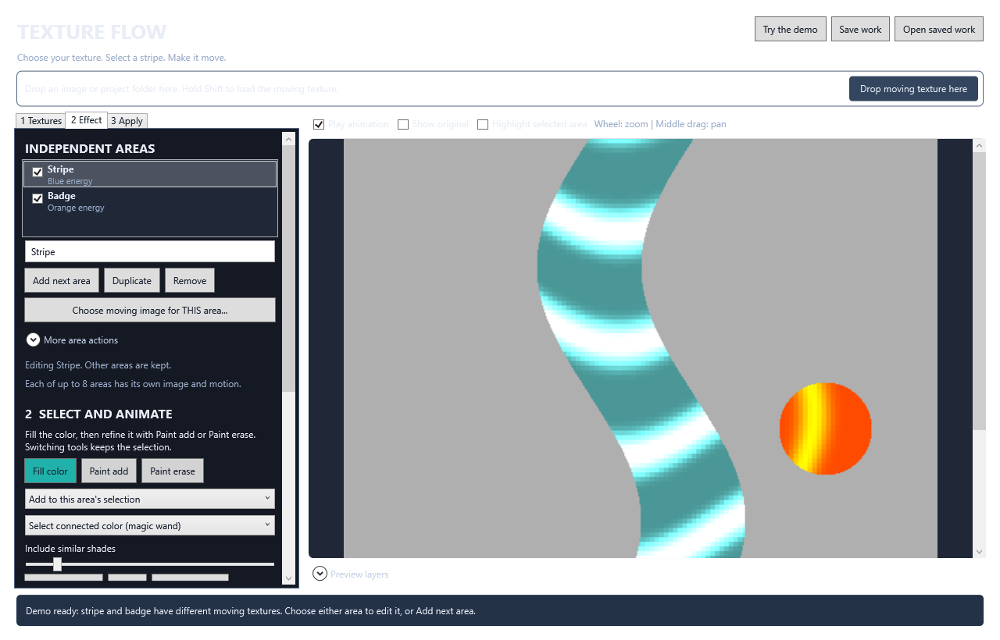

# Texture Flow for VRChat — 0.3.0 preview

Project home: `A:\VRChat Texture Flow`. All source, build tools and release files are kept here.

**Owner's handbook:** [T.A.R.D. Manual](T.A.R.D.%20Manual.md). It covers every control, first use, automatic application, restoration, troubleshooting, project files, limitations and a technical handoff. Browser-readable HTML and printable PDF copies accompany the manual release.

Standalone Windows x64 texture masking and scrolling-emission editor, built with C# / WPF. The portable release includes the .NET runtime and Unity companion. No Photoshop or separate .NET installation is required.

## Run

Use `TextureFlow-0.3.0-Setup.exe` for a per-user installation, or extract the portable ZIP **completely** and run `TextureFlow.exe`. Keep its `UnityPackage` directory beside the EXE. Windows 10/11 x64 is the intended platform. The application and installer are unsigned.

Version 0.3.0 adds **up to eight independent areas on one original texture/material**. Each area has its own mask, moving image, direction, speed, repetition, rotation and tint. Newly created areas use neutral white tint so images keep their colors.



The app has three tabs:

1. **Textures**: choose your Unity project, then open the original avatar texture and the moving pattern. **Browse its textures** shows searchable thumbnails from Assets and installed packages. Dragging files/folders still works. **Try the demo** loads two already-selected areas with different moving patterns.
2. **Effect**: select an area, choose its moving image, and refine it with **Fill color**, **Paint add** and **Paint erase**. Tool changes keep the current mask. Click **Add next area** for another independent region; select an earlier row to revisit it. Choose direction, speed and glow for the selected area. Advanced selection, edge cleanup, tiling, rotation and shader controls are collapsed until needed. Areas can be named, duplicated, enabled/disabled, removed/restored and reordered. Later areas cover earlier areas where masks overlap. Add-to-selection is the default; Replace and Remove are also visible. The clean animation preview is shown by default; **Highlight selected area** shows the mask overlay.
3. **Apply**: keep the selected project open in Unity with your avatar's scene loaded and Play mode off. Click **Connect to Unity / refresh avatar parts**. Texture Flow installs or updates its own included companion automatically; allow Unity to finish importing. Choose the intended avatar part from the readable list, then click **Create & Apply**. If exactly one slot uses the original texture, it is selected automatically. Multiple matches require you to choose one.

The app creates every enabled area's textures/mask and combines them into one material, waits for Unity's import confirmation, applies to the selected renderer material slot, then reports Unity's response. No manual material dragging or coding is needed. VCC and Unity's installed application code are untouched. The included editor extension lives under `Assets/TextureFlow/Companion` in your selected project. **Save the scene in Unity (Ctrl+S)** to keep the assignment. This action does not upload anything to VRChat.

**Restore previous material** restores the most recent app-applied assignment for that project. Original material references and a material backup are recorded inside the export; Unity Undo/Redo also works. A restore will stop if that slot was assigned a newer material in the meantime. The restore record survives reopening the app; restoring after restarting Unity requires the original saved scene and avatar part to be open again. Unsaved/recreated scenes or deleted backups can prevent restoration.

For export without applying, expand **Save files without applying** in the Apply tab and choose **Create Unity material only**. Files are created in a unique `Assets/TextureFlow/Exports/Flow-...` folder. **Save work** writes a `.tflow` session and adjacent `.tflow.assets` folder; keep both when sharing.

Source textures and original shared materials are not edited. Create & Apply assigns the generated opaque Built-in Render Pipeline material to the one chosen slot. It can change that slot's overall shading because it does not carry across normal maps, metallic settings or custom toon features. Use opaque PC avatar clothing/shoes and inspect the result in Unity before uploading. Other slots remain unchanged. Third-party shader presets remain experimental exports; automatic application uses the tested Texture Flow material.

If no connection appears, click Unity's window, wait for its imports/compilation to finish, leave Play mode and refresh. Other compile errors in the project must be resolved for editor extensions to run. If no avatar parts appear, open the scene containing the avatar. The app uses standard MeshRenderer/SkinnedMeshRenderer slots, so it does not require a particular avatar vendor or shader to list targets. Compatibility is tested with Unity 2022.3.22f1 and PC Built-in projects; this is not a guarantee for every Unity version, render pipeline or existing package configuration. Use the app-managed companion installation rather than installing a second copy manually.

## Implemented

- Connected color flood fill (0–255 channel tolerance), global color/HSV selection, soft add/subtract brush, lasso and polygon.
- Non-destructive selection mask, per-area selection undo/redo, square grow/shrink, separable feather, morphological smoothing and enclosed hole filling.
- Base, selection, flow and emission preview toggles; original comparison, zoom, pan, play/pause. The independent area list can be reordered; this is not a general Photoshop layer editor.
- Independent masks, images and motion/glow settings for up to eight areas; direction/speed presets, tiling, rotation and neutral-default tint. Fill selections can be brush-refined and expanded; Ctrl+Z, Ctrl+Y and Ctrl+Shift+Z operate on the active area outside text fields.
- VCC saved projects, Unity Hub saved projects, active project lockfile detection, default Hub Unity editor installation discovery, manual project browsing, file/folder/path drag-and-drop, and searchable project texture thumbnails. VCC files and settings are never modified.
- Full-resolution PNG source/flow/mask/cutout export, JSON metadata and portable sessions. Source image alpha is preserved in cutout export.
- Unity editor companion imports masks as linear/clamped data, flow as repeating color, creates materials, processes new requests while the editor is running, provides live avatar-part discovery and one-click application from the desktop app, and keeps restore backups with Unity Undo support.
- Custom Built-in Render Pipeline shader keeps the mask fixed while scrolling the underlying texture. PC VRChat avatars only. Glow beyond the surface depends on the world's bloom configuration.

## Third-party shaders and remaining work

`Animated.mat` is always generated using TextureFlow's shader and is the reference composite. Selecting Poiyomi or lilToon additionally attempts `Native.mat`, using installed shader properties for emission, pan and masks. The companion reports missing shaders/properties or unsupported rotation in `flow-result.json`, preserving the fallback material. Native exports are single-area only. Multi-area effects always use the included shader. Native adapters are experimental: full Poiyomi/lilToon version compatibility, visual equivalence, shader locking/build stripping, and VRChat upload behavior have **not** been validated. No third-party shaders are redistributed.

Not implemented: AI selection, pressure input, rainbow/pulse, the named animation preset library, a reorderable layer stack, an emission color-picker dialog, continuous desktop-to-Unity parameter streaming, custom Unity installation discovery outside the default Hub location, ARM64 releases, and Quest shaders. Exporting again currently creates a new effect rather than updating a previous export in place. Unity imports exports live, but the app does not claim a synchronized 3D preview.

## Performance and verification

Images up to 8192×8192 are accepted. Masks operate at source resolution; the animated desktop preview uses at most 640 pixels in width. Preview targets a 16 ms timer but **60 FPS is not guaranteed**; composition currently runs on the UI thread. Large operations run on background workers. An 8192² mask grow took roughly 0.5 seconds on the development machine. Several full-size images plus undo history can require over 1 GB of memory. Large-image painting, full export throughput and sustained 60 FPS have not been benchmarked.

Validation: 71 desktop checks cover connected/disconnected selection, HSV, morphology against a naive reference, feather, holes, polygon, subtract brush, WPF preview, export, cutout alpha, source preservation and 8192² processing. An isolated Unity 2022.3.22f1 project imported the generated shader and material and checked texture references, velocity and linear/clamped mask settings. The new bridge passed 35 Unity checks covering exact-slot application, other-slot preservation, material backups, Undo/Redo, restore, replay handling, stale targets/sessions, expired commands, non-export paths and Play-mode refusal. A Direct3D11 GPU test rendered independent red/green regions, checked untouched pixels and overlap/disable behavior, and exercised all eight shader areas. Two live integration checks clicked the actual desktop Create & Apply (with two independently animated areas) and Restore actions against a running disposable Unity editor and verified restoration of the original material GUID. Visual appearance on your particular avatar and VRChat upload still need user testing.

## Build

.NET 9 SDK with Windows desktop support:

```powershell
 dotnet build ./src/TextureFlow -c Release
 dotnet run --project ./tests -c Release -- 'A:/VRChat Texture Flow/build/desktop-test'
 ./tests/Run-UnitySmoke.ps1
 ./tests/Run-LayerRender.ps1
 ./tests/Run-LiveApply.ps1
 ./Build.ps1 -InnoCompiler 'C:/path/to/ISCC.exe'
```

The tests create assets and install the companion in the supplied disposable project; do not pass an avatar project. The build writes self-contained portable ZIP and optional Inno Setup EXE in `A:\VRChat Texture Flow\build\releases`. No signing certificate is configured. The app automatically manages `UnityPackage` as an editor extension; do not install a second copy in the same project.

Reference documentation: [VRChat Unity version](https://creators.vrchat.com/sdk/upgrade/current-unity-version/), [Poiyomi emission](https://www.poiyomi.com/10.0/special-fx/emission), [lilToon emission](https://lilxyzw.github.io/lilToon/ja_JP/color/emission.html).


## Drag-and-drop and the icon

The supplied pixel-art image is embedded as a multi-resolution Windows EXE icon, the main/window taskbar icon, the texture browser icon and the installer icon. No image service or external icon file is needed at runtime.

Dragging is supported when the source supplies standard Windows file paths or text containing local paths/file URIs (including relative `Assets/...` paths with a project selected). This works without changing VCC. VCC project cards may not themselves provide a drag payload; use the automatically detected project list or VCC's Open Folder action and drag from Explorer in that case. This release does not add a drag source to VCC or claim that every Unity/VCC control supports outward dragging. URL-only downloads, `.unitypackage` archives and remote image retrieval are not supported by drag-and-drop.

Browser scans are read-only, cancellable and run in the background. Results use a virtualized list and two concurrent thumbnail decoders, retaining previews only for visible rows. HDR/EXR and layered PSD previews are converted to an 8-bit display/editing surface; original files remain untouched. Native Unity import settings, embedded sprites and cubemap faces are not represented separately.

Image decoding uses Magick.NET 15.0.0. Its copyright and bundled native-library notices are included in the release's `Licenses` folder.


Saved work now uses schema 2 and stores all area masks/images/settings. Old single-area schema-1 work and exports remain readable by version 0.3.0; version 0.2 cannot read new multi-area work. A completely empty draft is ignored on export; an enabled partial area reports what is missing. Mask undo retains up to four states per area within a shared 256 MiB history budget. Multiple large masks/textures can need substantially more memory than one area; eight simultaneous 8192-square image workflows have not been performance-certified.
