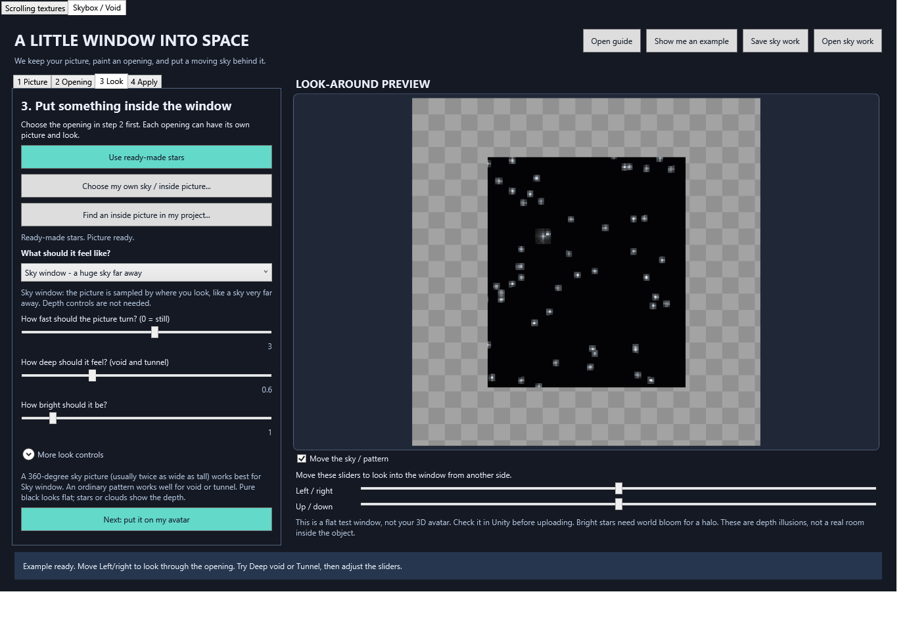

# Texture Flow ? Skybox / Void Guide
Version 0.4.0 ? Windows x64 ? A beginner guide and technical handoff

## Start here
Imagine your avatar picture is a piece of paper. Paint a window on that paper. Put stars behind the window. Now moving your head changes what you see inside.

Open **Skybox / Void** at the top of Texture Flow. Your usual tools are under **Scrolling textures**. These workspaces are separate. The original source files have not been edited; the new feature is added by new files.

For a first try, click **Show me an example**. A gray test picture appears with a star window. Move **Left / right** below the preview. Choose another look in **3 Look**. No Unity project is needed for this first try.

## The order: picture, opening, look, apply

### 1. Picture: choose what your avatar already wears
Choose your Unity project. If it is missing, click **Find my project folder** and choose the folder containing Assets and ProjectSettings. Open that same project through VCC in the usual way.

Click **Choose my avatar picture** to open an image file, or **Find its picture in this project** to browse thumbnails. This is the shoe, shirt, face or other original texture, not the stars. The app does not rewrite your source image.

Already painted stripes in Scrolling textures? **Copy my current scrolling work** copies the original picture, masks and inside pictures into this separate workspace. Your scrolling work stays as it was. The sky/void looks are chosen separately here.

Click **Next: paint the opening**.

### 2. Opening: paint only the part that should show space
Click **Paint my opening**. This opens the familiar Texture Flow selection tools. The colored highlight means ?put the effect here?; it is not the final color.

1. Choose the area row you want to edit.
2. Choose the connected-color/fill tool and click the stripe or patch.
3. Adjust tolerance if it selects too much or too little. Lower means pickier. Higher includes more similar colors.
4. Change to **Paint add** to fill missing bits. Change to **Paint erase** to remove mistakes. Changing tools keeps the selection.
5. Use the existing brush-size and soft-edge controls to tidy the edge. A small brush helps corners. A soft edge blends gently.
6. Use Undo selection or Ctrl+Z for a mistaken mask edit; Redo restores it. This history belongs to each area and is limited. It is not an undo system for every setting or file operation.
7. Use the existing advanced selection tools if useful: grow makes the opening larger, shrink smaller, feather softens it, smooth tidies noisy edges, and fill holes closes enclosed gaps. Lasso/polygon tools help shapes that color tools cannot isolate.
8. Click **Done ? see my sky / void**.

**Use the whole picture as the opening** selects every pixel for the chosen area. Use this for an entirely star-filled material. It still affects only the material slot you apply to, not every part of an avatar.

For another independent opening, use the existing add-area control in the painting window. Paint its mask, click Done, and choose that opening in step 2. Then give it its own picture and look in step 3. Up to eight areas are supported. Later areas cover earlier areas where they overlap. Area enable/reorder controls remain in the painting window.

### 3. Look: choose what lives inside each opening
Choose an opening in step 2 first. **Use ready-made stars** supplies a simple starting image. **Choose my own sky / inside picture** opens your file; the project browser offers thumbnails.

| Look | What it does | Best image |
| --- | --- | --- |
| Sky window | Looks like a distant sky seen through the painted shape; the view changes with the camera direction | A 360-degree equirectangular panorama, usually twice as wide as tall |
| Deep void | Repeats an image at several apparent depths; dark parts let you see farther layers | Bright stars or shapes on a dark background |
| Twisting tunnel | Turns and scales repeated depth layers toward the middle | Dark repeating grids, rings or star patterns |

Selecting a look resets that opening's look controls to a useful preset. It keeps its mask and image. Adjust the controls after choosing the look.

| Control | Meaning and useful starting point |
| --- | --- |
| Turn speed | Degrees per second, from -45 to 45. Zero stops turning; negative reverses it. Try 2?3 for a calm sky, 10 for a tunnel. |
| Depth | Apparent layer separation, 0.05?2. Larger creates stronger parallax. Used by void/tunnel only; start near 0.6?0.8. |
| Brightness | Multiplies the inside picture, 0?8. Zero is black; 1 keeps normal brightness. A halo also needs world bloom. |
| Depth layers | 1?8 repeated pictures. More layers cost more GPU work. Start at 4. |
| Pattern repeats | 0.1?8, for void/tunnel. Higher makes repeated details smaller. Start at 1?1.5. |
| Pattern drift | -0.2?0.2 texture repeats per second. Zero stops vertical drift; negative reverses it. The mesh UV direction affects how it looks. |
| Starting turn | 0?360 degrees. Changes where the image begins. |
| Tint | #FFFFFF keeps the source colors. #FF0000 tints red, #00FF00 green, #0000FF blue. Enter # plus six hexadecimal digits. |
| Keep sky still when avatar turns | Sky window only. On uses world directions; off follows the object's rotation. |
| Move the sky / pattern | Plays/pauses the desktop animation only. It does not pause Unity. |
| Left/right and Up/down | Move the pretend eye around a flat preview panel. These are preview controls, not exported avatar settings. |

Disabled controls are unused by the selected look. A plain black image stays plain black: the depth effect needs visible details. An ordinary photograph can stretch in Sky window; use a panorama or choose void/tunnel.

### 4. Apply: put the finished material on one avatar part
1. Keep the chosen project open in Unity. Open the scene containing your avatar instance. Leave Play mode off.
2. Click **Connect and find my avatar parts**. Texture Flow installs/updates its own companion inside that project's Assets/TextureFlow/Companion folder. You do not write code or edit VCC/Unity installation files.
3. Wait for Unity to import. If it waits, click Unity's window and check the Console for errors.
4. Choose the exact avatar part and material slot from the list. Read its avatar/material name. Do not guess if several look similar.
5. Click **Create and apply my sky / void**. Wait for an Applied message. Creating files alone is not the same as assigning the material.
6. In Unity, inspect the result from several angles. Save the scene with Ctrl+S.

This button creates Void.mat and assigns it to the one chosen slot. It does not upload an avatar, save the scene automatically, or change the world's skybox. This is a custom unlit shader; the original slot's lighting, transparency, normal maps and special shader features are not reproduced. Even pixels outside the opening can look different under scene lighting.

**Undo my last sky / void material change** restores the previous assignment for the last remembered sky/void apply in this project. It refuses if the slot has since been assigned a different material. Unity Undo is also recorded. Mask Undo is separate. Repeated applies each create a new material/receipt; the desktop restore button remembers only the most recent one.

**Only create files** makes assets and requests material creation without changing a renderer. With Unity closed, material creation waits until the project imports in Unity. The PNGs alone do not prove Void.mat was created.

## Recipes

**A quiet star stripe:** choose your shoe texture ? paint the stripe ? ready-made stars ? Sky window ? turn 2 ? brightness 1 ? choose the shoe's slot ? apply.

**A deep space badge:** paint the badge ? stars ? Deep void ? depth 0.8 ? four layers ? drift 0.015 ? brightness 1?2 ? apply. Move the preview eye to check parallax.

**A twisting void sleeve:** paint the sleeve ? dark patterned image ? Twisting tunnel ? depth 1.2 ? six layers ? turn 10 ? apply. If too busy, lower turn, layers and brightness.

**Two different effects:** paint opening one and choose stars/Sky window; add opening two with the existing area tools, paint it, and choose a different inside image/Tunnel. Both export together. Check overlaps and enable states.

## Save and reopen
**Save sky work** creates a .voidflow file plus a uniquely named .painting-?.tflow file and its assets folder. Keep all of them together. **Open sky work** restores masks, inside images and individual looks. It does not restore a live renderer connection; reconnect and choose the intended target.

Saving creates a new painting snapshot so an earlier one is not overwritten during the save. Old snapshots remain beside the work file. Keep them until you are sure they are no longer needed. Saved work may contain private avatar artwork; the app does not determine sharing rights.

## If something goes wrong
| Symptom | What to do |
| --- | --- |
| Nothing inside | Check the area is enabled, has a painted mask and an inside image; raise brightness above zero. |
| Wrong area changed | Use material Restore, then check the renderer/slot and mask. |
| Blue image | Set Tint to #FFFFFF for that opening. Selection highlight is not the final picture. |
| Seams or stretching | Use a seamless 2:1 panorama for Sky window. Try another image or void/tunnel for ordinary patterns. |
| No depth | Move the preview eye; use visible stars/details, increase depth, choose void/tunnel. Sky window is intentionally far away. |
| More openings needed | Open Paint my opening, use Add area, paint it, then give that opening its own look in step 3. |
| Connect waits | Same project open? Avatar scene open? Play mode off? Click Unity, wait for compile/import, read Console, reconnect. |
| Material is pink | Check Console and void-result.json. Keep the included SkyboxVoid.shader installed. |
| Apply says something changed | Reconnect and reselect the exact part. Stale identities/materials are rejected on purpose. |
| Timeout | Inspect the current assignment in Unity before retrying. An operation already in progress may finish near a timeout. |
| Restore refuses | A newer assignment may exist; the app preserves it. Check the receipt/backup and Unity Undo. |
| Glow has no halo | Brightness is not bloom. The VRChat world's post-processing controls the halo. |
| App feels slow | Use fewer areas/layers and smaller inside pictures. Large masks and undo states use memory. |

## What is supported
Windows x64 desktop, Unity Built-in rendering, PC-oriented custom shader. Images use the original app's 8-bit raster pipeline; PNG export keeps decoded dimensions and pixels, but source HDR/layer information is not retained. Generated textures are imported uncompressed with a maximum size of 8192. Original source files remain untouched.

The preview is a flat test panel, not a 3D avatar preview. It is calculated on a worker at up to 25 requested frames per second, with no guaranteed sustained rate. It clips values above display white; Unity's HDR/bloom may differ. The effects create finite depth illusions, not actual portals, an infinite room or geometry you can enter. Quest/Android, URP/HDRP and native Poiyomi/lilToon versions of these new effects are not implemented. VR headset/VRChat upload appearance still requires testing in the intended avatar/world.

## Developer handoff: keep the original intact
All pre-existing tracked files are frozen by compatibility/legacy-0.3.0-sha256.json. Do not edit those files for this feature. Directory.Build.targets supplies version 0.4.0. New partial classes and a module initializer attach the new outer tab, preserve the original root UI and create a separate original-tool window. New look state is attached to effect layers without changing the original model.

New files: SkyboxVoidBootstrap, MainWindow.VoidTools, SkyboxVoidTab XAML/code, VoidModels, VoidFiles; Unity VoidImporter, VoidBridge and SkyboxVoid.shader. The existing installer copies the entire companion directory, so the original installation implementation is reused unchanged.

New exports are Assets/TextureFlow/Exports/Void-? with base.png, cutout.png, mask.png, per-layer PNGs/session.json, void-request.json, void-result.json and Void.mat. Each apply adds apply-backup-?.json and PreviousMaterial-?.mat. Do not remove assets or .meta files referenced by the avatar.

Commands use Library/TextureFlow/Void/requests and results with a separate desktop-restore.json. Discovery/session identity still uses the original connector. VoidBridge enforces expiry, editor state, exact renderer/global identity, slot, expected material identity, export-only paths, Void.mat and the custom shader. Restore delegates to the original guarded restore implementation. VCC and Unity installation files are not altered.

Build: `./Build-SkyboxVoid.ps1 -InnoCompiler 'A:/VRChat Texture Flow/tools/InnoSetup/ISCC.exe'`.

Tests: `dotnet run --project tests-void -c Release -- 'A:/VRChat Texture Flow/build/void-test'`, then `./tests-void/Run-Unity.ps1`. Use disposable projects only. Run the original tests as regressions. Desktop tests validate frozen files, workspace separation, view/time/depth changes, save/reopen and export; Unity tests validate material generation, guards, restoration and actual D3D11 rendering. See release verification notes for recorded results; this is not a guarantee for every avatar/headset.

If stuck, isolate the stage: source decode ? mask ? preview ? PNG export ? void-result.json ? command result ? scene assignment. Preserve restore receipts and backups. Never treat an import success as proof of assignment. Read the original T.A.R.D. Manual for the unchanged tools and support procedures.
