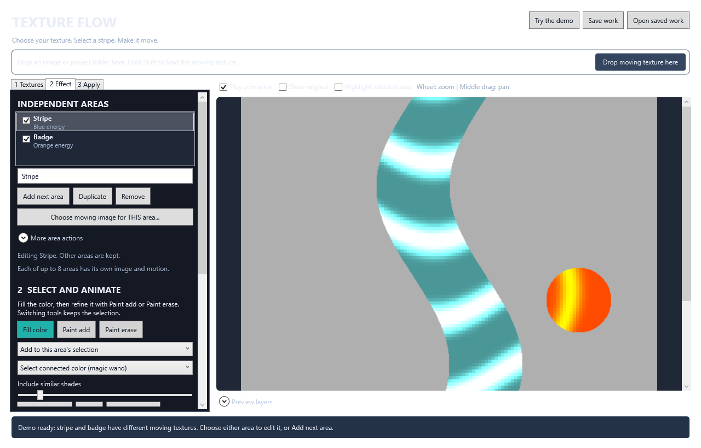

# T.A.R.D. Manual

## Texture Flow for VRChat: owner's guide and recovery handbook

**App version: 0.3.0 preview. Manual edition: November 24, 2026.**

This handbook explains how to operate Texture Flow, recover from problems, and hand the project to another developer or assistant without relying on an old conversation.

**The essential sequence is: choose textures, select the stripe, choose the avatar part, click Create & Apply, then save the scene in Unity.** The program does not upload an avatar to VRChat.

## Contents

- [1. What the application does](#1-what-the-application-does)
- [2. Requirements and compatibility](#2-requirements-and-compatibility)
- [3. Install, open and update](#3-install-open-and-update)
- [4. First test: the included demo](#4-first-test-the-included-demo)
- [5. Prepare your avatar project](#5-prepare-your-avatar-project)
- [6. Tab 1: Textures](#6-tab-1-textures)
- [7. Tab 2: Effect](#7-tab-2-effect)
- [8. Tab 3: Apply](#8-tab-3-apply)
- [9. Restore and recover an earlier look](#9-restore-and-recover-an-earlier-look)
- [10. Save, reopen and share work](#10-save-reopen-and-share-work)
- [11. Files and folders](#11-files-and-folders)
- [12. Poiyomi, lilToon and appearance limits](#12-poiyomi-liltoon-and-appearance-limits)
- [13. Troubleshooting by symptom](#13-troubleshooting-by-symptom)
- [14. Collect information for support](#14-collect-information-for-support)
- [15. Backup, cleanup and uninstall](#15-backup-cleanup-and-uninstall)
- [16. Known limits and unfinished features](#16-known-limits-and-unfinished-features)
- [17. Verification record for 0.3.0](#17-verification-record-for-030)
- [18. Technical handoff and architecture](#18-technical-handoff-and-architecture)
- [19. Build, test and recover development](#19-build-test-and-recover-development)
- [20. Owner decisions and remaining work](#20-owner-decisions-and-remaining-work)
- [21. References and glossary](#21-references-and-glossary)

## 1. What the application does

Imagine a shoe texture with a black stripe. You select the stripe, and the program creates a mask describing its shape. The generated material displays a moving pattern inside that fixed shape. The rest of the texture stays in place.

There are two separate selections:

- **Image region:** the pixels inside the stripe or other shape.
- **Avatar part:** the Unity renderer material slot that receives the generated material.

Selecting the stripe does not tell the app which shoe, avatar or scene object should use it. The app can select a unique part using the original texture. If more than one part uses it, you choose the intended part.

Each of up to eight independent areas has its own moving image, mask, speed, direction, repetition, rotation and tint. All enabled areas are combined in one material on the original texture.

A mask is a grayscale image: white enables the effect, black disables it, and gray creates a soft transition. The app also exports a cutout PNG. The normal automatic material composites the effect over an **opaque** surface. It does not cut physical holes in the model or turn the final material into a transparent shader.

## 2. Requirements and compatibility

| Item | Supported or tested behavior |
| --- | --- |
| Desktop application | Windows 10/11 x64; C#/.NET/WPF |
| Runtime | Included in the installer and portable release |
| Tested Unity editor | Unity 2022.3.22f1 |
| Intended avatar platform | PC VRChat, Built-in Render Pipeline |
| Avatar dependency | No specific vendor; targets are standard MeshRenderer/SkinnedMeshRenderer material slots |
| Automatic-apply shader | Included TextureFlow/Masked Scroll shader |
| Poiyomi/lilToon | Experimental optional exports, not fully validated native integrations |
| Maximum image dimensions | 8192 by 8192 pixels |
| Independent areas | Up to eight per original texture/material; PC shader model 4.0 |
| VCC | Used for project discovery/opening; its installed code and settings are not modified |
| Project permissions | The app writes its own companion, exports and connection files in the selected project |

This is a preview, not a guarantee for every Unity version, render pipeline, shader or package configuration. Quest/Android shaders, URP/HDRP and ARM64 releases are not implemented.

## 3. Install, open and update

### Installer

Run `TextureFlow-0.3.0-Setup.exe`. It installs per user, normally under `%LocalAppData%\Programs\TextureFlow`, and offers shortcuts. You do not need a separate .NET installation to run it.

### Portable ZIP

Extract `TextureFlow-0.3.0-Portable-win-x64.zip` completely, then run `TextureFlow.exe`. Keep the `UnityPackage` directory beside the executable. Running directly inside the ZIP, or copying only the EXE, can prevent companion setup.

```text
TextureFlow.exe
UnityPackage/
  package.json
  Editor/FlowImporter.cs
  Editor/FlowBridge.cs
  Shaders/MaskedScroll.shader
Licenses/
README.md
```

A `.pdb` debugging file and copies of this manual may also be included. The app and installer are unsigned. Obtain the owner's release and compare published SHA256 checksums when checking for a damaged or different download.

### Development computer location

The project was deliberately moved out of the unrelated Arma workspace. Its home is:

```text
A:\VRChat Texture Flow
```

Source is under `src`, the companion under `UnityPackage`, and downloads under `build\releases`. The local portable EXE is `build\portable\TextureFlow.exe`. A `Texture Flow.lnk` shortcut at the root points to the latest local build; a staged release may live in a different build subfolder. Other creators do not need this drive or directory structure.

### Updating

Close Texture Flow before replacing its EXE. Run the newer installer or extract the newer portable ZIP into a separate folder. Preserve saved `.tflow` work and its adjacent assets folder. Connecting/exporting updates this tool's own companion in the selected Unity project.

Use the app-managed companion. A second manual copy can cause duplicate editor classes and compilation errors.

## 4. First test: the included demo

1. Open the app and click **Try the demo**.
2. The app switches to **2 Effect**. The stripe and badge already have different moving textures. Select either area row to edit its settings.
3. Try the direction and speed buttons. The outline should stay fixed.
4. Use **Show original** to compare, then turn it off.
5. For a Unity test, create a temporary cube in a disposable scene/project. The connector lists ordinary cubes as well as avatar parts.
6. In **1 Textures**, select that project and open the same project in Unity.
7. In **3 Apply**, click **Connect to Unity / refresh avatar parts**. Wait for import/compilation and leave Play mode off.
8. Choose the cube's material slot, then click **Create & Apply**.
9. Inspect it in Unity. Enter Play mode after applying if needed to make animation obvious; view the cube in the Scene tab. Leave Play mode before applying/restoring again.
10. Click **Restore previous material**, then remove the temporary cube when finished.

A successful test shows a moving pattern inside a stationary stripe. A bright surface confirms emission. A surrounding halo depends on the scene's bloom; it is not guaranteed by the material alone.

The demo does not automatically identify a real avatar part. Choose the test cube or intended slot explicitly instead of assuming the first row is correct.

## 5. Prepare your avatar project

Open the intended project in Unity, normally through VCC. Open the scene containing the avatar instance. Avatar files in the Project panel alone are not enough: the target must be in an open, loaded scene.

Save the scene under a recognizable name before starting. A saved scene gives restoration a stable object identity across editor restarts. Keep your normal project backup too; a material backup is not a complete avatar/project backup.

Identify the intended part. A shoe renderer may have several slots, and the same texture can be shared by several outfits or avatars. The target list provides hierarchy, material and slot names.

For a first real effect, use opaque clothing/shoes. The generated material replaces the chosen slot's shader appearance. It does not automatically carry over normal maps, metallic settings, toon settings or other custom shader features.

## 6. Tab 1: Textures

### Choose the project

The list reads saved VCC and Unity Hub projects, checks known projects for Unity's lockfile, and lists editor folders in the default Hub installation directory. Readable names appear in the project selector; hover an item for its full path.

Use **Choose project folder** if a project is missing. Select the root containing both `Assets` and `ProjectSettings`, not just Assets, an avatar download folder, or a `.unitypackage` file. Discovery reads VCC settings; it does not modify them or install a VCC plugin.

### Original and moving textures

**Open original avatar texture** loads the actual image used by the material, not a screenshot of the avatar. Loading a different original starts a fresh area workspace and clears existing area masks/history. Save work first if you want to retain the previous workspace.

**Open moving texture for selected area** chooses the image that moves inside the currently selected area. In Effect, **Choose moving image for THIS area** replaces only that area's image and keeps its mask; **Add next area** starts an independent empty area. A seamless pattern hides repeating edges better. It may have different dimensions from the original.

### Browse its textures

The browser searches filenames, folders and extensions. Space-separated terms must all occur in a result's relative path. Each visible result shows a thumbnail, name, path and file information.

- **Use as base texture:** loads the original image.
- **Use as animated texture:** loads the moving image.
- Double-click: loads the original image.
- **Include installed package textures:** includes embedded/local/resolved cached package sources where dependency metadata permits discovery.
- **Refresh:** searches again after files change.

Supported source extensions: PNG, JPG/JPEG, BMP, TIF/TIFF, TGA, PSD/PSB, EXR, HDR, DDS, GIF, WebP, IFF and PICT. Individual codecs/files can still fail; the browser reports the error. Animated sources use their first frame, not a flipbook. Layered/high-bit-depth files are converted to an 8-bit editing/display surface; originals remain untouched.

Generated/procedural textures, serialized Unity Texture2D `.asset` files, imported sprite sub-assets and individual cubemap faces are not separately listed as ordinary source files. The browser does not reproduce every Unity importer setting.

### Drag and drop

| Drop | Result |
| --- | --- |
| One image on the main window | Loads the original |
| One image on Drop moving texture here | Loads the moving texture |
| One image while holding Shift | Loads the moving texture |
| Two images | Original plus moving texture, in the source's supplied order |
| Project folder or path inside a project | Selects the containing project when identifiable |
| Local path/file URI as text | Resolves the local file/folder; relative Assets paths use the selected project |

Both images decode before a two-image drop replaces the current layers. If the second fails, the existing layers are kept. More than two images are rejected; use the browser for larger collections.

The source application must expose a Windows file/path drag payload. Texture Flow cannot make a VCC card draggable if VCC does not expose one. Use the detected list or drag from Explorer. Remote downloads and `.unitypackage` extraction are not drag features.

## 7. Tab 2: Effect

### Create several independent areas

1. Select **Area 1**, fill its color/region, then refine it with **Paint add** and **Paint erase**. These tools operate on the same mask; changing tools does not clear it.
2. Click **Choose moving image for THIS area** and choose its pattern. Set its direction, speed, glow and tint.
3. Click **Add next area**. The previous area is retained and continues to preview. Select a new color or part and give it another image/settings.
4. Repeat for a third area, up to eight. Click any existing row to edit that area's mask, image or settings again. There is no destructive "finish" step.
5. Create & Apply combines all enabled, completed areas into one material for the chosen avatar slot.

Rename an area in the field below the list. Its checkbox controls whether it appears in preview **and export**. **Duplicate** copies its mask/settings independently. **Remove** affects the selected area; **Restore removed area**, under **More area actions**, recovers the most recently removed area. If the list is already full, remove an unused area before restoring another.

**Move earlier/later** changes overlap priority: later rows cover earlier rows where masks overlap. Nonoverlapping regions remain independent. **Add moving image as NEW area**, under More area actions, creates an area with that image and an empty mask. Brush/cleanup settings are editing tools; motion/tint belong to each area.

A totally empty draft area is ignored when exporting completed areas. An enabled area with only a mask or only an image reports what is missing; finish it, disable it, or remove it. Hidden areas are retained in saved work.



The demo stripe and badge use different patterns and speeds. Choose an area row to return to it without losing the other region. Use Show original while selecting if existing animated areas obscure the source colors.

### Select the stripe

The default is **Select connected color (magic wand)**. **Fill color**, **Paint add** and **Paint erase** are visible shortcuts; the current shortcut is highlighted. **Add to this area's selection** is the default selection mode, so further color fills expand the mask. Choose Replace to start its mask again or Remove to subtract matching pixels. Shift-click adds and Alt-click subtracts with color/outline tools. Click inside the stripe. Increase **Include similar shades** to include neighboring dark gray with black. If unwanted areas join the selection, Undo and try a smaller tolerance.

| Tool | Behavior |
| --- | --- |
| Select connected color | Matching pixels connected to the clicked pixel |
| Select this color everywhere | Matching pixels across the image, including disconnected regions |
| Select similar hues everywhere | Uses hue, saturation and brightness tolerances against the clicked pixel |
| Brush: add area | Paints into the mask |
| Brush: remove area | Paints out of the mask |
| Draw around an area (lasso) | Drag an outline and release to close it |
| Click around an area (polygon) | Click boundary points; double-click to finish |

Color tolerance is 0–255 and compares the largest difference among RGB channels. Zero means exact channel matching, not "select nothing." Hue uses circular distance with separate saturation/value tolerances.

### Advanced selection and edge cleanup

| Control | Behavior/range |
| --- | --- |
| Selection mode (visible above the tool list) | Add, Replace or Remove for fills/outlines; changing to a brush retains the mask |
| Hue tolerance | 0–180 degrees around the clicked hue |
| Saturation / brightness tolerance | Each 0–1 |
| Brush size | 1–512 source pixels in diameter |
| Brush softness | 0 hard edge; 1 broad soft edge |
| Cleanup amount | Radius of 1–128 source pixels |
| Grow / Shrink | Expands/contracts using square neighborhoods |
| Soften edges | Box feather producing gray mask edges |
| Smooth | Morphological opening; removes noise/protrusions and can remove small selected details |
| Fill gaps | Fills enclosed holes, not only tiny holes |
| Undo selection / Redo | Up to four retained states per area, subject to a shared 256 MiB history budget |
| Clear selection | Clears the mask; selection Undo can normally recover the previous state |

Cleanup changes only the selected area's mask, not the source image or other areas. Ctrl+Z undoes the active area's mask; Ctrl+Y or Ctrl+Shift+Z redoes it. Text fields keep their normal text-editing shortcuts. Large workspaces may have older histories trimmed to stay within the memory budget. Start with a small radius, particularly around fine artwork.

### Movement and glow

| Setting | Meaning/range |
| --- | --- |
| Right / Up / Left / Down | 0 / 90 / 180 / 270 degrees in texture coordinates |
| Custom direction | 0–360 degrees, under Advanced motion |
| Speed | 0.01–100 texture-coordinate units/second |
| Slow / Medium / Fast | 0.05 / 0.25 / 1 |
| Repeat X / Y | Each 0.01–1000 |
| Rotation | Static pattern rotation, 0–360 degrees |
| Glow strength | 0–100 |
| Pattern tint | Hex; default `#FFFFFF` keeps the moving image's colors |
| Extra HDR brightness | -10 to 16 stops; emission multiplies by 2 to this power |

Up means texture-preview up, not world up. UV layouts can rotate/mirror the image on the model; inspect in Unity and adjust direction if needed. Glow strength zero removes extra emission but still leaves the moving pattern as surface color. The Pattern tint colors the entire moving image, not only its emission. New areas start white; old saved work retains its original tint, including any cyan tint chosen by older releases. Start with strength 2 and HDR 0; high values can wash out detail.

### Preview controls

**Play animation** pauses/resumes the desktop preview only; it does not export a Unity stop-animation switch. **Show original** displays the source. **Highlight selected area** shows the mask overlay; disable it for a clean result. Wheel zooms, middle-button drag pans. **Preview layers** contains Original texture, Moving texture and Glow display toggles.

These toggles are preview options, not switches that remove components from the exported material. This is a 2D composite rather than a live 3D avatar view. Exports retain source resolution despite the reduced preview size.

## 8. Tab 3: Apply

### Connect

Keep the selected project and avatar scene open in Unity, leave Play mode, then click **Connect to Unity / refresh avatar parts**. The app installs/updates its own companion automatically. Allow Unity to import and compile; click Unity's window if it needs a refresh.

No code pasting/editing is required. Project-wide compilation errors from any package can prevent editor extensions from running.

### Choose the exact target

The list contains loaded scene MeshRenderer/SkinnedMeshRenderer material slots, including ordinary cubes and inactive child objects. Preview scenes are excluded. A row resembles:

```text
My Avatar / Shoes | Shoe material (slot 0)
```

Check the avatar hierarchy, part and slot. A unique original-texture match can be selected automatically. Multiple matches require a choice; the app does not mean "all avatars" when several rows match.

### Create & Apply

After preparing the enabled areas and selecting an intended target, the button:

1. Checks images, selection, connection and target information.
2. Creates a new export containing separate images, masks and settings for every enabled, completed area.
3. Waits for Unity to create the animated material.
4. Requests assignment of `Animated.mat`, containing all the enabled areas, to that one slot.
5. Waits for Unity's response and displays success or the reason it stopped.
6. Records the previous reference and a material snapshot for restoration.

Other slots are preserved. This is a real edit to the open Unity scene, but not a modification to VCC or Unity installation code.

**Save the scene in Unity to keep the assignment.** The app marks it dirty but does not silently save your other scene edits. It does not upload to VRChat, change the SDK avatar identity or publish a world.

### Create files without assigning

Expand **Save files without applying** and choose **Create Unity material only**. Files and a material request are created, but the avatar is not assigned a new material. Unity creates `Animated.mat` after import. Manual assignment also remains available under **Tools > Texture Flow > Apply Animated Material** in Unity.

## 9. Restore and recover an earlier look

Select the same project, connect, and click **Restore previous material** to reverse the latest recorded app assignment. This restores the whole material assignment, including its combined areas; use desktop selection Undo to fix an individual mask instead. Save the scene afterward if you want to keep the restored state. Unity Undo/Redo also works; that history is not a permanent backup.

Each application records what occupied the slot immediately before it. After several applications, the most recent previous material may itself be an older generated effect. Restore handles the latest recorded step, not an unlimited chain back to the avatar's original look.

### When Restore is unavailable

Check project, connection and Play mode. The app pointer is `Library/TextureFlow/desktop-restore.json`; the receipt and material snapshot are in the corresponding export. Clearing Library can remove the pointer without removing the export's backups.

For manual recovery, inspect the appropriate `PreviousMaterial-<request-id>.mat` in Unity and assign it to the intended slot. Keep the receipt so a developer can identify the original reference. A `.mat` snapshot can reference other assets: copying it alone is not a complete portable backup.

### When Restore refuses

If that slot received a newer material assignment, restore stops to preserve it. Inspect the current Unity assignment before doing anything else. Repeated clicks do not remove the check.

Across Unity restarts, restoration needs the original saved scene and object open again. Unsaved scenes, recreated/deleted objects, lost scenes, missing originals or deleted backups can prevent recovery. Use a project backup when material-only recovery is insufficient.

## 10. Save, reopen and share work

**Save work** requires an original texture and stores every area, including disabled or unfinished ones. It creates:

```text
Shoe Energy.tflow
Shoe Energy.tflow.assets/
  base.png
  flow.png
  mask.png
  cutout.png
  session.json
  layer-01/mask.png
  layer-01/flow.png
  layer-02/mask.png
  layer-02/flow.png
```

Each area's moving image is present when loaded; incomplete drafts can omit it. Root mask/cutout describe the enabled combined regions, and the root flow is a first-image compatibility copy. Schema-1 single-area work from version 0.2 can be opened by 0.3, but 0.2 cannot open new schema-2 multi-area work. Keep the file and adjacent folder together. The session uses a relative assets-folder name. The mask remains editable after reopening. Loading rejects assets outside the session's containing directory.

Renderer connections are not portable session data: reconnect and choose the intended target in the recipient's project. Saving over the same name updates its saved assets; use a new name for a separate version.

Sharing a session can share avatar artwork. The app does not determine redistribution rights. Use the generic demo when you do not want to include personal or paid-avatar textures.

## 11. Files and folders

Each export has its own timestamped folder:

```text
Assets/TextureFlow/
  Companion/
    Editor/FlowImporter.cs
    Editor/FlowBridge.cs
    Shaders/MaskedScroll.shader
    package.json
  Exports/
    Flow-<timestamp>-<suffix>/
      base.png
      flow.png
      mask.png
      cutout.png
      session.json
      layer-01/mask.png
      layer-01/flow.png
      layer-02/mask.png
      layer-02/flow.png
      flow-request.json
      flow-result.json
      Animated.mat
      Native.mat                       (if a native adapter succeeds)
      apply-backup-<request-id>.json    (after automatic application)
      PreviousMaterial-<request-id>.mat (if the previous slot was not empty)
```

Unity adds `.meta` files. Preserve them when moving assets so their references remain consistent.

| File | Purpose |
| --- | --- |
| base.png / flow.png | Exported original and moving images |
| mask.png | Combined enabled-area mask for cutout/reference; each layer folder contains its independent fixed mask |
| cutout.png | Original image with alpha reduced in selected areas |
| session.json | Effect configuration |
| flow-request.json | Material-creation request |
| flow-result.json | Unity's material import result |
| Animated.mat | Normal automatic-apply material using the included shader |
| Native.mat | Experimental native-shader material if successfully created |
| apply-backup-*.json | Target identity, original reference and restore information |
| PreviousMaterial-*.mat | Snapshot of previous material properties |

The connector uses a separate local folder:

```text
Library/TextureFlow/
  connection.json
  desktop-restore.json
  requests/<request-id>.json
  results/<request-id>.json
```

Library files are local connection/cache state, not avatar assets. Exported assets and backups may be referenced by a scene. Do not treat all of `Assets/TextureFlow` as disposable.

## 12. Poiyomi, lilToon and appearance limits

The Advanced shader choice affects optional native exports. `Animated.mat` is always generated with the included shader and is used by **Create & Apply**. Selecting a native shader does not cause that button to assign `Native.mat`. Native exports are single-area only; multi-area exports use the included shader and report this in the import result.

Native adapters attempt emission, masks, pan and tiling through installed properties. Missing shaders/properties or unsupported native rotation are reported in `flow-result.json`. The standard material remains available. Cross-version appearance, locking/build stripping and VRChat upload behavior of native adapters have not been comprehensively validated.

The normal shader supplies a lit, opaque scrolling effect with emission. It does not duplicate every original material feature. A whole slot can look different even if the selected stripe is small. Original references/backups let you go back.

Desktop brightness does not guarantee a bloom halo in a world. World lighting, post-processing, exposure and shader restrictions affect the result. Inspect it in Unity and the intended VRChat context before considering it finished.

## 13. Troubleshooting by symptom

| Symptom | First actions |
| --- | --- |
| App will not open | Fully extract the ZIP; use Windows x64; close the old instance before replacing files; try a fresh extraction or installer |
| Project missing | Choose the root manually; confirm Assets and ProjectSettings exist |
| VCC card will not drag | Use the detected project list or drag from Explorer; the card may not provide a drag payload |
| Browser empty | Check project, clear search, enable package textures; generated/serialized textures are not ordinary image results |
| Thumbnail error | Try another file; check whether it opens elsewhere; retain the error message |
| A second image replaces the first | Select Add next area or Add moving image as NEW area; choosing an image for THIS area intentionally replaces that one image |
| Cannot refine a filled selection | Select the existing area row; use Paint add/erase. Keep Add mode for additional fills; changing tools keeps the mask |
| Image is tinted blue | Set this area's Pattern tint to #FFFFFF; old saved work retains its earlier tint |
| An area disappears | Check its enable checkbox and overlap order; a later opaque mask can cover an earlier one |
| Selection includes unwanted gray/black | Undo, lower tolerance and use add/remove brushes |
| Disconnected black regions selected | Choose connected-color rather than whole-image color selection |
| Overlay obscures effect | Turn off Highlight selected area |
| Pattern appears outside stripe | Check mask/selection and that you are viewing the generated Animated.mat |
| Motion reversed on shoe | UVs can rotate/mirror the image; change direction and inspect again |
| Pattern seam visible | Use a seamless source or adjust repetition/rotation |
| Pattern washed out | Reduce Glow strength/HDR and inspect scene exposure/bloom |
| No glow halo | Emission and bloom are separate; the scene/world controls bloom |
| Connect keeps waiting | Open the same project, click Unity's window, wait for import/compile, leave Play mode and check Console errors |
| No avatar parts | Open the scene containing the avatar instance, not only its prefab file in the Project panel |
| Several/wrong parts | Read hierarchy/material/slot labels and explicitly choose the intended slot |
| Apply asks for a region | Select or paint a visible area in Effect |
| Stale part/material error | Refresh and reselect after changes in Unity |
| Files exist but material not ready | Read flow-result.json and Console; source PNGs do not prove successful material import |
| Assignment not confirmed | Inspect Unity before retrying; a timeout is not proof that an in-flight assignment did not finish |
| Old shading details lost | The new shader replaces that slot's shading; Restore if unsuitable |
| Change disappears after reopening | Save the scene after applying/restoring; Play-mode-only edits should not be expected to persist |
| Restore disabled/refuses | Check project, connection, saved scene, restore record and newer assignments |
| Duplicate class errors | Look for a second manual/old companion copy; preserve backups and keep one installation |

### Understand the status message

Connection, material creation, assignment and restoration are separate stages. Export success is not assignment success. Record the exact message and button when something stops.

The app normally waits about 35 seconds for connection, up to 45 for material import, and about 40 plus a short recheck for an assignment response. These are timeouts, not guaranteed completion times for large or broken projects.

Unprocessed assignment requests are withdrawn after a desktop timeout, and commands have an expiry. A request already being processed can still finish near a timeout; inspect Unity before retrying. Replay checks help prevent a processed command from being assigned twice.

## 14. Collect information for support

Provide:

1. App, Windows and Unity versions.
2. The tab and exact button used.
3. The complete status/error message.
4. Whether the selected project and avatar scene are open.
5. Whether Unity is importing, compiling or playing.
6. Target hierarchy/material/slot, redacted if sharing publicly.
7. Relevant Unity Console errors.
8. Relevant flow-result/connector result JSON and restore receipt.
9. Whether the demo works in a disposable project.

Unity's local editor log is normally `%LocalAppData%\Unity\Editor\Editor.log`. Logs/JSON can contain private paths and avatar/object names: review before posting. Never upload credentials or authentication tokens.

There is no dedicated crash-upload service or guaranteed persistent desktop diagnostic log in this release. Save the visible error and relevant result files.

## 15. Backup, cleanup and uninstall

Keep independent project backups. Preserve saved scenes, originals, source textures, referenced Texture Flow exports and Unity `.meta` files.

Desktop uninstall does not remove exports or the companion from projects. A portable folder can be removed after closing the app and preserving saved work.

Before project cleanup, restore or choose the assignments you want and back up the project. Do not remove the generated shader while materials still rely on it: missing shaders can make surfaces pink. Removing editor scripts does not undo scene assignments.

Clearing Library forces reimport and removes local connection state, including the remembered restore pointer. It is not the first troubleshooting step. Receipts/snapshots under Assets are separate and should be preserved.

## 16. Known limits and unfinished features

The original product wish list is not a completed feature list:

- No AI-assisted subject/object selection. Simplifying the UI did not introduce an AI engine.
- The independent effect areas can be reordered, but this is not a general Photoshop-style editor with arbitrary image layer types.
- No rainbow/pulse modes or named energy/lava/fire/water preset library.
- No pressure input or emission color-picker dialog; color is hex input.
- No synchronized 3D desktop avatar preview or continuous parameter streaming to Unity.
- Re-export creates a new folder rather than updating a prior effect in place.
- No Quest/Android, URP/HDRP or ARM64 release support.
- Native Poiyomi/lilToon adapters remain experimental.
- Apply does not preserve all original material/shader features.
- Browser results are source files, not every Unity-generated texture sub-asset.
- 8-bit editing/export does not retain all HDR/PSD authoring information.
- Large-image painting, export throughput and sustained 60 FPS are not comprehensively benchmarked.

The preview samples at most 640 pixels in width. Its timer targets roughly 16 ms, but composition runs on the UI thread and 60 FPS is not guaranteed. Large source arrays, multiple masks/images and undo states can use substantially more than 1 GB. Up to four undo states per area share a 256 MiB history budget; eight simultaneous 8192-square workflows are not performance-certified. An 8192-square grow operation took roughly 0.5–0.8 seconds in recorded development runs; this is a local observation, not a hardware guarantee.

## 17. Verification record for 0.3.0

Recorded successful checks:

- **71 desktop checks:** selection, cleanup, source preservation, export, codecs, drag data, thumbnails/search, three-step UI, connection/ambiguity/expiry/busy handling, 8192-square masks, fill-to-brush refinement, add/subtract masks, independent areas/settings, duplication/removal, multi-area saving/export, disabled/draft handling and legacy sessions.
- **35 Unity checks:** shader/material/mask/velocity, readable targets, exact-slot apply, other-slot preservation, backups, Undo/Redo, restore, replay handling, stale identities/sessions/materials, expiry, restricted paths, saved-scene recovery, file commands, Play-mode refusal, multi-area material count/textures/velocities/tints, fixed second masks and legacy imports.
- **GPU rendering check:** Direct3D11 output verified independent red/green regions, untouched original pixels, overlap priority, disabled areas and full eight-area shader compilation.
- **Two live integration checks:** actual desktop Create & Apply with two independently animated areas and Restore actions communicated with a running disposable Unity 2022.3.22f1 editor; the original material GUID was restored.

Packaged EXE startup/version and correspondence between packaged companion and tested source were checked. These tests do not prove every avatar's visual appearance, every native shader version or a VRChat upload.

## 18. Technical handoff and architecture

Ordinary ownership does not require the following developer details. They are included so another developer or assistant can continue the project.

```text
src/TextureFlow/
  TextureFlow.csproj          .NET 9 Windows WPF, app 0.3.0
  App.xaml / App.xaml.cs      Application entry
  MainWindow.xaml            Three-step UI and named controls
  MainWindow.xaml.cs         Selection, preview, sessions, export entry
  MainWindow.Import.cs       Texture browser and file/path drops
  MainWindow.Unity.cs        Connection, target choice, apply/restore
  MainWindow.Effects.cs      Independent area state, switching, tools, undo/redo
  LayerCompositor.cs         Multi-area desktop composition
  WorkspaceFiles.cs          Versioned sessions/export and validation
  Imaging.cs                 Raster arrays, masks, FlowSettings
  ProjectTextures.cs         Project lookup, scan and decode
  TextureBrowser.xaml[.cs]   Virtualized browser
  ProjectNameConverter.cs    Readable project names
  Assets/AppIcon.png/.ico    Supplied image and embedded Windows icon
UnityPackage/
  Editor/FlowImporter.cs     Texture import/material creation
  Editor/FlowBridge.cs       Target discovery, commands and backups
  Shaders/MaskedScroll.shader
  package.json
Build.ps1                    Publish, ZIP, installer, checksums
installer.iss                Per-user Inno Setup installer
Licenses/                    Dependency notices
tests/                       Desktop, Unity and live integration tests
```

On the development machine use `A:\VRChat Texture Flow`, not the old Arma directory. Do not edit VCC installation files or Unity binaries to implement app features.

### Desktop design

The project targets `net9.0-windows` and publishes self-contained for `win-x64`. Magick.NET-Q8-x64 15.0.0 decodes images; WPF bitmap APIs support preview/PNG output. Dependency notices ship with releases.

Source rasters are BGRA byte arrays; the mask is a separate byte per pixel. Up to four mask undo states per area are retained within a shared 256 MiB history budget. Area image/mask/motion state survives switching; the active fields are synchronized before switching, saving, exporting and rendering. Large selection/cleanup operations use workers; preview composition is currently on the UI thread.

The browser scans asynchronously with a virtualized list and two concurrent thumbnail decoders. Visible-row references are released on unload. Package-cache enumeration consults dependency metadata to avoid indiscriminately listing stale cached versions.

### Unity importer

The desktop writes flow-request.json after export/companion files. The importer processes pending requests, imports the mask as linear/clamped data and the flow image as repeating color data, and creates Animated.mat. Material creation and scene assignment have separate result files. Request/result timestamps determine pending import work.

The fallback shader supports up to eight independent mask/pattern pairs. It shares flow and mask sampler states on Direct3D11, with shader target 4.0. Later areas blend over earlier albedo and emission at overlaps. Each pattern has its own time-based velocity, repetition, rotation, tint and emission. Emission is tinted/masked. It is an opaque Built-in surface shader, not a universal preservation layer for original shaders.

Session/export **schema 2** stores an array of area records containing names, enable state, relative image/mask paths and motion settings. The reader/importer still accepts legacy schema 1. Validate area count, settings, mask dimensions and relative paths before replacing a workspace or modifying imports. Blank drafts can be saved; only enabled, completed areas enter an export.

### Connection and commands

Protocol version is **1**. The bridge publishes connection.json about every two editor seconds. The desktop polls about once per second and considers a heartbeat older than ten seconds stale.

A snapshot contains session ID, timestamp, busy state and targets. Targets include renderer instance/global IDs, slot, expected material instance/GUID, source texture path and label. Unity SessionState preserves the session identifier through assembly reloads within one editor session.

Commands/replies use Library/TextureFlow/requests and results. Actions are apply/restore. Commands contain request ID, session ID, expiry and target/material or receipt. Normal commands expire about one minute after creation.

Assignment checks editor state, session, expiry, renderer/global identity, slot and expected material. Apply accepts the generated Animated.mat within Assets/TextureFlow/Exports with the expected shader. It backs up the previous reference/properties, changes one shared-material array element, records prefab-instance changes, marks the scene dirty and supports Unity Undo. It does not save the scene automatically.

Restore verifies that the current slot still contains the applied material. A repeat apply request with an existing matching receipt/current assignment returns already-applied rather than assigning again. Saved-scene restore can resolve global object identity after restarting the editor.

JSON writes use temporary files/renames. A short replace/read race is possible, so readers tolerate transient missing/partial data. A timeout is not proof an in-flight operation did not finish; support advice/status should preserve this nuance.

### Maintenance constraints

- Keep desktop JSON property names compatible with Unity's serialized field names.
- WPF target display bindings need properties: the desktop AvatarTarget.label is a property, not merely a field.
- Touch controls on the dispatcher; use workers for decoding/filtering.
- Disable project/target/apply actions while a request is running; prevent duplicate clicks.
- Never silently pick among multiple matching avatar parts.
- Preserve stale-target, expected-material, session, expiry, Play-mode and restore-conflict checks.
- Keep source arrays unchanged and verify mask polarity/cutout alpha.
- Preserve the supplied icon and drag/browser functionality.
- Keep UnityPackage content external to the single-file EXE (`ExcludeFromSingleFile=true` plus publish-copy metadata). The connector reads that physical directory. Verify archive contents after publishing; an EXE that starts is not proof its companion files were shipped.
- Do not claim native-shader, Quest, AI or universal compatibility without implementation/testing.
- Do not publish personal avatar textures, caches, logs or credentials as source.

## 19. Build, test and recover development

Developer commands, run from the product directory:

```powershell
Set-Location 'A:\VRChat Texture Flow'
dotnet build .\src\TextureFlow -c Release
dotnet run --project .\tests -c Release -- 'A:/VRChat Texture Flow/build/desktop-test'
.\tests\Run-UnitySmoke.ps1
.\tests\Run-LayerRender.ps1
.\tests\Run-LiveApply.ps1
.\Build.ps1 -InnoCompiler 'A:/VRChat Texture Flow/tools/InnoSetup/ISCC.exe'
```

Rebuilding needs the .NET 9 SDK and Windows desktop support; running the release does not require an SDK. Without InnoCompiler, Build.ps1 produces the portable app/ZIP but does not compile the installer. Outputs and SHA256 checksums are under build/releases. Close the portable app before overwriting its executable. To build while leaving the normal portable folder alone, use a separate staging directory:

```powershell
.\Build.ps1 -PortableDirectory 'build/manual-release-stage' -InnoCompiler 'A:/VRChat Texture Flow/tools/InnoSetup/ISCC.exe'
```

The ZIP and installer then use that staging directory. Archive creation uses a temporary ZIP and replaces the finished download only after successful compression.

**Use disposable test locations, never a personal avatar project.** Tests create images/exports/companion files, open/create scenes and materials, and change test assignments. Unity scripts default to the installed 2022.3.22f1 editor path; pass `-UnityExe` if yours is elsewhere. Their current disposable project is build/unity-apply-test.

Useful results:

```text
build/desktop-test/desktop-tests.txt
build/unity-apply-test/desktop-tests.txt
build/unity-apply-test/unity-smoke-result.txt
build/unity-apply-test/unity-smoke.log
build/unity-apply-test/live-apply-result.txt
build/unity-apply-test/live-unity.log
```

The GPU render harness needs a working Direct3D11 GPU and runs without -nographics. The normal smoke suite is headless. The live harness starts/stops its own hidden batch Unity process. Do not attach it to the user's active avatar project.

### When a developer or assistant is stuck

1. Read this handbook, README and relevant source before changing behavior.
2. Reproduce with the demo in a disposable project.
3. Identify the failing stage: decode, selection, export, material import, connection, assignment or restore.
4. Read the matching result file, not just the UI status.
5. Preserve existing scene/material references before recovery.
6. Make a focused repair and run tests covering that failure.
7. Run Unity/live tests for companion, protocol, apply or restore changes.
8. Verify packaged companion/source correspondence and EXE startup.
9. Update this manual for behavior/limit changes; publish versioned downloads/checksums.

A moved test project's old Library/Bee cache once failed to include a new script. A clean disposable unity-apply-test compiled successfully. This is a test-environment lead, not permission to delete a user's Library or ignore genuine compiler errors.

## 20. Owner decisions and remaining work

The owner requested a dedicated, shareable Windows scrolling-emissive-mask creator: independent of Unity as an application, with minimal masking work and no manual Photoshop/code work. The owner approved automatic updates of **Texture Flow's own companion inside selected projects**, while leaving VCC/Unity installations unchanged.

The source/build home is a new top-level A-drive directory. The provided pixel-art image is embedded in the EXE, windows/taskbar and installer. The simplified interface has three tabs. Version 0.3 adds independently editable areas, additive fills, visible brush shortcuts, per-area undo/redo, multi-area save/export and neutral white default tint. Automatic assignment must remain target-specific and recoverable rather than guessing among avatars.

The original wish list remains a roadmap, not a completed feature list. Valuable next work includes preserving more original material features, validating native adapters, improving large-image preview performance, clearer original-texture provenance in sessions and stronger setup diagnostics. AI selection and section 16's other unfinished features remain future work.

This handbook describes version 0.3.0. Update its version, tests, protocol and limits when the product changes.

## 21. References and glossary

Primary references for adjacent tools:

- [VRChat creator documentation](https://creators.vrchat.com/)
- [VRChat Unity version guidance](https://creators.vrchat.com/sdk/upgrade/current-unity-version/)
- [Creator Companion documentation](https://vcc.docs.vrchat.com/)
- [Poiyomi emission](https://www.poiyomi.com/10.0/special-fx/emission)
- [lilToon emission](https://lilxyzw.github.io/lilToon/ja_JP/color/emission.html)
- [Magick.NET](https://github.com/dlemstra/Magick.NET)
- [Unity sampler-state sharing](https://docs.unity.cn/jp/2022.3/Manual/SL-SamplerStates.html)

App source/tests determine its own behavior. External shader documentation does not turn an experimental adapter into validated support.

| Term | Plain meaning |
| --- | --- |
| Texture | Image placed on a 3D model |
| Mask | Image controlling where an effect appears |
| Material | Unity's shader, texture and surface settings |
| Shader | Rendering code that determines surface appearance |
| Renderer | Component that draws a mesh/skinned mesh |
| Material slot | Position in the renderer's material list |
| UVs | Coordinates placing an image on a model |
| Emission | Surface brightness independent of ordinary lighting |
| Bloom | Viewing/post-processing effect that can add a halo |
| Scene | Open Unity arrangement containing the avatar instance |
| Prefab | Reusable object asset, distinct from its scene instance |
| Companion | Texture Flow's included project editor extension |
| Export | Creates files/material request; not necessarily assignment |
| Apply | Assigns generated material to one chosen slot |
| Receipt | Saved target/previous-material restoration record |

**Remember: Textures → Effect → Apply → save the Unity scene.**
